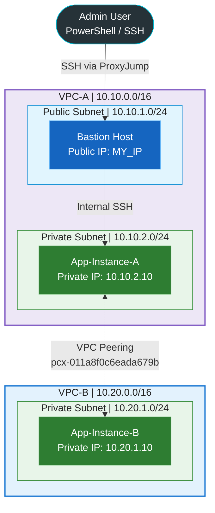

# AWS Secure Cross-VPC Connectivity via Peering & Bastion Host

A hands-on AWS cloud networking project implementing secure, private communication between two isolated Virtual Private Clouds (VPCs) using VPC Peering, a Bastion Host, custom route tables, and SSH ProxyJump.

<div align="center">
  

  <br /><br />

  
  
  
  
</div>

---

## 🚀 Project Overview

This project demonstrates how to establish secure private network connectivity between two independent AWS Virtual Private Clouds (VPC-A and VPC-B).

The architecture uses a public Bastion Host in VPC-A to provide administrative access to private application instances, while VPC Peering enables direct communication between workloads using their private IPv4 addresses.

The project focuses on network isolation, routing, controlled access, and connectivity validation.

---

## 🏗️ Architecture Summary

- **Cloud Provider:** Amazon Web Services (AWS)
- **Region:** Asia Pacific (Mumbai) — `ap-south-1`
- **VPC-A:** `10.10.0.0/16`
  - Public Subnet: `10.10.1.0/24`
  - Private Subnet: `10.10.2.0/24`
- **VPC-B:** `10.20.0.0/16`
  - Private Subnet: `10.20.1.0/24`




### EC2 Instances

| Instance     | Private IP   | Network          |
| ------------ | ------------ | ---------------- |
| Bastion Host | `10.10.1.10` | Public Subnet A  |
| App-A        | `10.10.2.10` | Private Subnet A |
| App-B        | `10.20.1.10` | Private Subnet B |

### Connectivity Design

- VPC Peering provides private communication between VPC-A and VPC-B.
- The Bastion Host provides administrative SSH access.
- Private application instances do not require public IPv4 addresses.
- Custom route tables provide forward and return paths.
- Security Groups restrict inbound SSH and ICMP traffic to specified lab hosts.

---

## 📂 Repository Structure

```text
AWS-VPC-Peering-Project/
│
├── architecture/
│   └── vpc-peering-diagram.png
│
├── docs/
│   └── implementation-report.pdf
│
├── screenshots/
│   ├── vpc-configuration.png
│   ├── subnet-configuration.png
│   ├── route-tables.png
│   ├── security-groups.png
│   ├── ec2-instances.png
│   ├── peering-connection.png
│
└── README.md
```

---

## 🛠️ Implementation Highlights

### 1. VPC and Subnet Provisioning

Created two independent VPCs with non-overlapping IPv4 CIDR blocks. Configured public and private subnets with explicit route table associations.

### 2. Internet Gateway

Attached an Internet Gateway to VPC-A and configured the public subnet route for Bastion Host connectivity. VPC-B does not use an Internet Gateway.

### 3. Security Group Configuration

Configured separate Security Groups for the Bastion Host, App-A, and App-B, restricting SSH and ICMP inbound access to the required private IP addresses.

### 4. EC2 Instance Deployment

Provisioned three Amazon Linux 2023 EC2 instances:

- One public Bastion Host.
- Two private application instances.

### 5. VPC Peering

Created and activated a VPC Peering Connection between VPC-A and VPC-B.

### 6. Route Table Configuration

Configured forward and return routes through the Peering Connection in both VPCs. Added the required peering route to the public subnet route table for Bastion-to-App-B connectivity.

### 7. Secure SSH Access

Configured secure SSH access to private application instances through the Bastion Host using local OpenSSH configuration and `ProxyJump`.

This approach enables direct access to private instances without transferring private SSH keys (`*.pem`) to remote servers.

**Local SSH Configuration (`~/.ssh/config`):**

```ssh-config
Host bastion
    HostName <BASTION_PUBLIC_IP>
    User ec2-user
    IdentityFile ~/.ssh/aws-lab-key.pem

Host app-a
    HostName 10.10.2.10
    User ec2-user
    ProxyJump bastion
    IdentityFile ~/.ssh/aws-lab-key.pem

Host app-b
    HostName 10.20.1.10
    User ec2-user
    ProxyJump bastion
    IdentityFile ~/.ssh/aws-lab-key.pem
```

With this configuration, private instances can be accessed using their SSH host aliases:

- `ssh app-a`
- `ssh app-b`

The SSH connection is routed through the Bastion Host while keeping private instances inaccessible directly from the public internet.

---

## 📸 Architectural Evidence

Project screenshots and implementation evidence are available in the `screenshots/` directory.

The evidence covers:

- VPC and subnet configurations.
- Route table associations and routes.
- Security Group inbound rules.
- EC2 instance configuration.
- Active VPC Peering Connection.
- SSH connectivity through the Bastion Host.
- Private IP connectivity tests.

Only screenshots captured during actual project execution are included.

---

## 🧪 Connectivity Validation

The project workbook requires the following validation tests:

| Test                         | Expected Result                              |
| ---------------------------- | -------------------------------------------- |
| Baseline ping before peering | No replies                                   |
| App-A to App-B               | Successful private connectivity              |
| App-B to App-A               | Successful private connectivity              |
| SSH through Bastion          | Private instance access                      |
| Controlled ICMP failure      | Ping blocked after rule removal              |
| Recovery                     | Connectivity restored after rule restoration |

Actual test outcomes are documented using captured execution evidence.

---

## 🔐 Security Considerations

- Private application instances have no public IPv4 addresses.
- SSH access is restricted to the Bastion Host.
- Security Group rules use specific source IP addresses.
- Private keys are kept on the local machine.
- No private keys, passwords, or AWS credentials are stored in this repository.
- Unnecessary lab resources are removed after evidence collection.

---

## 📚 Key Learnings

- AWS VPC architecture and IPv4 CIDR planning.
- Public and private subnet configuration.
- Internet Gateway and route table management.
- VPC Peering and bidirectional routing.
- Security Group traffic restrictions.
- Bastion Host architecture.
- SSH ProxyJump configuration.
- Private network connectivity troubleshooting.
- AWS resource lifecycle and cleanup.

---

## 🧹 Resource Cleanup

After collecting the required project evidence, the lab resources were cleaned up according to the project workbook to prevent unnecessary ongoing AWS charges.

---

## 👨‍💻 Author

**Aditya Mitra**

B.Tech Computer Science and Engineering
KIIT University

---

*Educational AWS networking project developed as part of the EWB Cloud Labs AWS Architect Associate internship program.*
